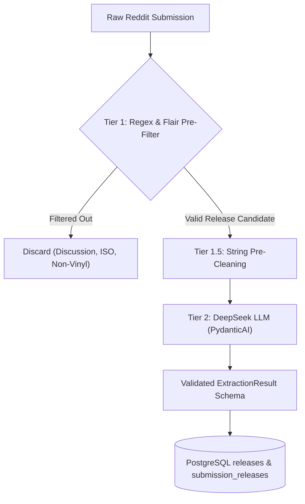

# r/vinylreleases Post Title Conventions, Flair Taxonomies, and Edge Cases

- **Date**: October 2026
- **Status**: Completed Research
- **Relevant Issues**: #2 ([Research] r/vinylreleases Post Title Conventions and Flair Edge Cases)
- **Relevant Architecture Docs**: `docs/spec/vinyl-releases-scraper.md`, `GLOSSARY.md`, ADR 0001, ADR 0003

---

## 1. Executive Summary

This research investigates community posting patterns, title conventions, flair taxonomies, edge cases, and noise filtration strategies across the `r/vinylreleases` subreddit. The findings directly inform the Ingestion Poller (PRAW), pre-cleaning normalization filters, and DeepSeek LLM extraction models (`pydantic-ai`) specified in `docs/spec/vinyl-releases-scraper.md`.

In accordance with `GLOSSARY.md`, this report adheres to standardized domain vocabulary: **Submission** (raw Reddit post), **Submission Snapshot** (timestamped metric observation), **Release** (distinct product announced), **Variant** (pressing variation), **Release Event** (commercial availability classification), **Hype Velocity** (metric rate of change), and **Hype Index** (fused hype metric).

---

## 2. Subreddit Posting Rules & Submission Standards

`r/vinylreleases` is a high-traffic community dedicated exclusively to announcing upcoming, newly available, and restocked vinyl records. Community moderation is governed by several core rules that impact ingestion:

### 2.1 The Official Formatting Rule (Rule #3)
Rule #3 explicitly governs post titles:
> **Title Format Standard**:  
> `Album Artist - Album Title (insert a brief description if necessary) [price & street date if available]`  
> **Official Rule Example**:  
> `Radiohead - In Rainbows (Rainbo Press) [$19.99 10/10/07]`

Key elements mandated by the subreddit:
- **Artist First**: Primary musical artist or group preceding the delimiter.
- **Delimiter**: A standard hyphen-minus `-` separating artist and album title.
- **Variant / Pressing Details**: Contained within parentheses `(...)` immediately following the title.
- **Pricing & Street Date**: Contained within square brackets `[...]` trailing the title.

### 2.2 Other Community Rules Affecting Ingestion
- **Rule 2 (Anti-Duplicate / Search Before Posting)**: Reposts within short time windows are removed by moderators. However, sudden restocks of previously sold-out releases are explicitly permitted as new submissions.
- **Rule 3 Format Restriction (Vinyl Only)**: Posts promoting CDs, cassettes, digital downloads, apparel, or equipment violate community rules and are removed by moderators. Occasional format bleed occurs before removal.
- **Rule 4 (No Discussion Posts / Reviews)**: General inquiries, unboxing videos, shipment delays, and speculation are prohibited and redirected to `r/vinyl` or pinned threads.
- **Rule 5 (Affiliate & Personal Resale Links)**: Direct links to eBay auctions, Discogs marketplace, or personal seller pages are prohibited unless offering 3+ copies at or below MSRP.

---

## 3. Real-World Title Conventions & Delimiter Variations

While Rule #3 specifies a canonical format, submissions submitted by thousands of individual users exhibit significant formatting diversity.

### 3.1 Anatomical Structure of Community Submissions
Real-world submissions typically conform to the following modular anatomy:

```text
[Prefix Tags] [Date / Region] Artist - Album Title (Variant / Pressing Info) [Retailer / Price / Limitation]
```

#### Component Breakdown:
1. **Prefix Tags** (`[...]` or `Word:`):
   - Event tags: `[Pre-Order]`, `[Restock]`, `[Repress]`, `[New Release]`, `[Release News]`, `[Drop]`
   - Status / Alert tags: `[Signed]`, `[Limited]`, `[Deluxe]`, `[Numbered]`
   - Geographic tags: `[US]`, `[UK]`, `[EU]`, `[Worldwide]`
2. **Artist & Album Separators (Delimiters)**:
   - Standard ASCII hyphen: `Artist - Title`
   - Unicode en-dash (`\u2013`): `Artist – Title`
   - Unicode em-dash (`\u2014`): `Artist — Title`
   - Colons: `Artist: Title` or `[Tag]: Artist - Title`
   - Forward slashes: `Artist / Title`
   - Pipe symbols: `Artist - Title | Variant`
   - Prepositional constructs: `Title by Artist`
3. **Variant Annotations (Parentheses `(...)` or Brackets `[...]`)**:
   - Colorways: `(Pink Swirl)`, `(Splatter Vinyl)`, `(Clear w/ Smoke)`, `(Opaque Violet)`
   - Disc count & weight: `(2xLP)`, `(180g Heavyweight)`, `(7" Single)`, `(Box Set)`
   - Novelty pressing features: `(Liquid-Filled)`, `(Zoetrope Picture Disc)`, `(Flexi Disc)`
   - Limitation counts: `(/500)`, `(Limited to 1,000 copies)`, `(LTD 300)`, `(Hand-Numbered /250)`
4. **Retailer & Exclusivity Tags**:
   - `[Target Exclusive]`, `[Rough Trade Exclusive]`, `[Blood Records]`, `[Newbury Comics]`
   - `[Bandcamp]`, `[Urban Outfitters Exclusive]`, `[VMP / Vinyl Me, Please]`
   - Prefix connectors: `@ Newbury Comics`, `via Rough Trade`, `on Bandcamp`
5. **Pricing & Release Date Tags**:
   - `[$29.99]`, `[£35.00]`, `[€40.00]`
   - `[Release Date: 11/14/26]`, `[Street Date 12/05]`, `[Ships Dec 2026]`

### 3.2 Real-World Title Catalog
| Pattern Category | Submission Title Example |
| :--- | :--- |
| **Standard Canonical** | `Fontaines D.C. - Romance (Opaque Emerald LP) [$32.99]` |
| **Prefixed Pre-Order** | `[Pre-Order] [10/24] Charli XCX - Brat (Translucent Black Ice Vinyl /2000) [Rough Trade]` |
| **Retailer Exclusive** | `Chappell Roan - The Rise and Fall of a Midwest Princess (Pink Target Exclusive LP)` |
| **Numbered Limitation** | `The 1975 - Live at Gorilla (Clear 2LP, Hand-Numbered /500) [Blood Records Zoetrope]` |
| **En-dash / Unicode** | `Miles Davis – Kind of Blue (Mobile Fidelity 180g 45RPM 2LP Box)` |
| **Restock Notification** | `RESTOCK: Tyler, The Creator - IGOR (Mint Green Special Edition LP)` |
| **Repress Announcement** | `Daft Punk - Discovery (2026 Repress / Japanese Import w/ Obi Strip)` |

---

## 4. Subreddit Flair Taxonomy & Lifecycle Dynamics

Subreddit post flairs serve as the primary categorical index for filtering submissions on `r/vinylreleases`.

### 4.1 Canonical Release Flairs
- **`NEW RELEASE`**: First-time vinyl release of an album or a brand-new contemporary album drop.
- **`RELEASE NEWS`**: Industry news, upcoming announcement teaser, or retailer tracklist announcement without a live purchase checkout link.
- **`PRE-ORDER`**: Advance sale prior to official shipping or manufacturing fulfillment.
- **`REPRESS`**: A new production pressing of an album that was previously issued and went out of print.
- **`RESTOCK`**: Existing inventory replenishment at a specific retailer storefront (e.g., returned copies, warehouse discoveries, or canceled bot orders).
- **`BOOTLEG` / `UNOFFICIAL`**: Unofficial pressings or lathe cuts (strictly permitted only when transparently labeled).

### 4.2 Dynamic Lifecycle Flair Mutations (`SOLD OUT` / `EXPIRED`)
A unique phenomenon on `r/vinylreleases` is post flair mutation:
1. A submission is created with flair `NEW RELEASE`, `PRE-ORDER`, or `RESTOCK`.
2. As collectors rush the retailer storefront, stock is depleted within minutes or hours.
3. Subreddit moderators or the submission author manually update the submission flair to **`SOLD OUT`** or **`EXPIRED`**.
4. Community members post "!soldout" or comment "OOS" (Out of Stock).

> [!IMPORTANT]
> **Hype Intelligence Opportunity**: Tracking the transition of a submission from `NEW RELEASE` to `SOLD OUT` provides an empirical measurement of real market demand. The ingestion poller should capture updated flair states across periodic snapshots to record the exact sold-out transition timestamp.

### 4.3 Non-Release Flairs & Rejection Filters
The following flairs must be dropped by the Ingestion Poller prior to database persistence or LLM extraction:
- `DISCUSSION`: Weekly/monthly threads, general discourse, collector queries.
- `QUESTION`: Queries regarding order fulfillment, pressing quality, or storefront legitimacy.
- `ISO` (In Search Of): Secondary market trade/purchase requests (prohibited under Rule 4).
- `ADVICE` / `COLLECTION`: Setup advice, turntable care, collection showcases.
- `PSA` / `WARNING`: Scammer storefront alerts, counterfeit notices.
- `EBAY` / `SCALPER`: Prohibited secondary-market auction links.

---

## 5. Pathological Edge Cases & Extraction Complexities

Unstructured submission titles present several major edge cases that cause traditional deterministic parsers to fail.

### 5.1 Soundtracks, Original Scores, and Video Games (OSTs)
Soundtracks rarely follow the standard `Artist - Album` structure:
- **Title as Subject**: Film, television, or game titles frequently replace the artist name:
  - Example: `The Elder Scrolls IV: Oblivion (Game Soundtrack) (Oblivion Gate Orange 2LP)`
  - Example: `Stranger Things: Complete Score (17-LP Box Set)`
  - Example: `Official UHF Score Soundtrack (37th Anniversary Deluxe 2LP)`
- **Composer vs. Performer**:
  - Example: `Hans Zimmer - Dune: Part Two (Original Motion Picture Soundtrack)` (Composer in artist slot)
  - Example: `OST - Cowboy Bebop (Seatbelts)` (OST tag used as artist)
  - Example: `Various Artists - Scott Pilgrim vs The World OST (Ramona Pink Vinyl)` (Compilation)

### 5.2 Collaborations, Splits, and Multi-Artist Releases
- **Collaborative Delimiters**: Artists joined by `&`, `and`, `x`, `vs`, `with`, or `feat.`:
  - Example: `Kanye West & Ty Dolla $ign - Vultures 1`
  - Example: `Tyler, The Creator - IGOR` (Internal comma within artist name)
- **Split Releases**: Multiple distinct bands sharing a physical record:
  - Example: `Converge / Dropdead - Split (7" /500)`

### 5.3 Artists & Titles with Internal Punctuation
Simple regex splitting on hyphens `-` breaks on bands with hyphens or symbols:
- Hyphenated artists: `blink-182`, `Jay-Z`, `Death Grips`, `t.A.T.u.`, `Godspeed You! Black Emperor`, `Sunn O)))`
- Punctuation in names: `Panic! At The Disco`, `AC/DC`, `Wham!`, `!!!` (Chk Chk Chk), `FKA twigs`
- Hyphenated album titles: `The Dark Side of the Moon - Live at Wembley 1974`, `S&M2 - Live`

### 5.4 Self-Titled Albums
- Marked as `Self-Titled`, `S/T`, or identical artist and title:
  - Example: `Paramore - Paramore (Indie Exclusive Tangerine Vinyl)`
  - Example: `The 1975 - S/T (10th Anniversary Clear 2LP)`
  - Example: `Beyoncé - Beyoncé (Deluxe Edition)`

### 5.5 Bootleg & Unofficial Pressing Disambiguation
- Community rules permit bootlegs only with explicit labeling:
  - Example: `[BOOTLEG] Frank Ocean - Nostalgia, Ultra (Orange Vinyl)`
  - Example: `Kanye West - Graduation (Unofficial Deluxe 2LP)`
- Parsers must detect `[Bootleg]` or `(Unofficial)` in the title or flair to mark `release_type = 'bootleg'` and avoid contaminating official discography feeds.

### 5.6 Multi-Item Dumps & Megathreads
Certain submissions announce batches of releases rather than a single record:
- Example: `VMP Restocks: Fiona Apple, Outkast, The Mars Volta, DMX`
- Example: `Assorted Blue Note Tone Poet Restocks [List in comments]`
- Example: `Target Buy 2 Get 1 Free Sale on Vinyl`
- **Architectural Implication**: Corroborates ADR-0001 (Decouple Submissions and Releases via `submission_releases`). A single submission can extract into 0, 1, or $N$ distinct `Release` records.

### 5.7 Repress vs. Restock Nuances
- **Repress**: The record was out of print and new copies have been physically manufactured at a pressing plant.
- **Restock**: A retailer has put previously depleted stock back on sale (inventory re-allocation, order cancellations). Sells out rapidly.

---

## 6. Extraction Pipeline Strategy: Regex Pre-Filter vs. DeepSeek LLM

### 6.1 Why Pure Regex Fails in Production
A naive regex such as `^([^-]+) - ([^(\[]+)(?:\((.*)\))?(?:\[(.*)\])?$` fails on over 40% of real-world submissions:
1. `blink-182 - Enema of the State` treats `blink` as artist and `182 - Enema of the State` as title.
2. `[Pre-Order] [10/24] Artist - Title` fails to capture artist due to stacked leading brackets.
3. Soundtracks (`The Elder Scrolls IV: Oblivion OST`) have no hyphen separator, causing matching failure.
4. Multi-item restock dumps cannot be decomposed into structured rows.

### 6.2 Recommended Two-Tier Hybrid Architecture



#### Tier 1: Deterministic Ingestion Poller Pre-Filter
- Fast rejection of non-release flairs: `Discussion`, `Question`, `ISO`, `Advice`, `Collection`, `PSA`.
- Fast rejection of title regex: `^\[?(Discussion|ISO|Question|PSA|Warning|Help)\]?`.
- Media format filtering: Drop non-vinyl formats (cassettes, CDs) unless accompanied by vinyl keywords.

#### Tier 1.5: String Pre-Cleaning
- Normalize Unicode dashes (`–`, `—`) to standard ASCII hyphens `-`.
- Normalize multi-space whitespace and strip decorative emojis.
- Clean markdown URL brackets and escaped characters.

#### Tier 2: DeepSeek LLM Semantic Extraction (`pydantic-ai`)
- LLM handles semantic disambiguation: correctly identifying artist vs. album even with hyphens in names.
- Recognizes implicit soundtrack titles and assigns canonical artist (`Hans Zimmer`, `Various Artists`, or original composer).
- Decomposes variants into structured fields (color, limitation, packaging).
- Extracts multiple releases from batch/restock submissions.

---

## 7. Concrete Implementation Recommendations

### 7.1 Pre-Cleaning & Filter Regex Module

```python
import re
from typing import Optional

NON_RELEASE_FLAIRS = {
    "discussion", "question", "iso", "advice", 
    "collection", "psa", "warning", "ebay", "deal"
}

NON_RELEASE_TITLE_PATTERN = re.compile(
    r"^\s*\[?(?:discussion|iso|question|psa|warning|help|survey|meta)\]?",
    re.IGNORECASE
)

NON_VINYL_PATTERN = re.compile(
    r"\b(cassette|tape|compact disc|\bcd\b)\b",
    re.IGNORECASE
)
VINYL_KEYWORD_PATTERN = re.compile(
    r"\b(vinyl|lp|ep|7\"|10\"|12\"|record|pressing|boxset|box set)\b",
    re.IGNORECASE
)

def should_ingest_submission(title: str, flair: Optional[str]) -> bool:
    """Pre-filter non-release submissions before database persistence."""
    if flair and flair.strip().lower() in NON_RELEASE_FLAIRS:
        return False
    
    if NON_RELEASE_TITLE_PATTERN.match(title):
        return False
        
    # Check for format bleed: reject cassette/CD posts unless vinyl is also mentioned
    if NON_VINYL_PATTERN.search(title) and not VINYL_KEYWORD_PATTERN.search(title):
        return False
        
    return True

def pre_clean_title(raw_title: str) -> str:
    """Normalize whitespace, unicode dashes, and clean common noise tags."""
    cleaned = raw_title.strip()
    # Normalize unicode en/em-dashes to standard hyphen
    cleaned = re.sub(r"[\u2010-\u2015\u2212]", "-", cleaned)
    # Normalize whitespace
    cleaned = re.sub(r"\s+", " ", cleaned)
    return cleaned
```

### 7.2 Enhanced Pydantic Extraction Schema

Refining the initial schema from `docs/spec/vinyl-releases-scraper.md` with concrete fields identified during research:

```python
from typing import Literal, Optional
from pydantic import BaseModel, Field

class ExtractedRelease(BaseModel):
    artist: str = Field(
        description="Name of musical artist, band, composer, or 'Various Artists'"
    )
    album_title: str = Field(
        description="Clean title of the album, EP, single, soundtrack, or box set"
    )
    format_variant: Optional[str] = Field(
        None, description="Raw variant text, e.g. 'Pink Swirl 2LP', '180g Audiophile'"
    )
    color_variant: Optional[str] = Field(
        None, description="Primary colorway description, e.g. 'Pink Swirl', 'Black Ice', 'Gold'"
    )
    limitation_count: Optional[int] = Field(
        None, description="Total limited pressing count if specified (e.g. 500 for /500)"
    )
    retailer: Optional[str] = Field(
        None, description="Exclusive seller or label (e.g., 'Blood Records', 'Target', 'Rough Trade')"
    )
    is_soundtrack: bool = Field(
        False, description="Whether this release represents a film, game, or television score/OST"
    )
    release_type: Literal[
        'new_release', 'pre_order', 'restock', 'repress', 'bootleg', 'unknown'
    ] = Field(
        'new_release', description="The release event classification"
    )
    confidence: float = Field(
        ge=0.0, le=1.0, description="Extraction confidence score from 0.0 to 1.0"
    )

class ExtractionResult(BaseModel):
    is_vinyl_release: bool = Field(
        description="Whether this submission represents an actual vinyl release announcement or drop"
    )
    releases: list[ExtractedRelease] = Field(
        default_factory=list, 
        description="List of distinct releases announced in the submission title"
    )
```

---

## 8. Summary of Recommendations for Downstream Issues

1. **Ingestion Poller (Issue #3)**:
   - Implement `should_ingest_submission()` to exclude `Discussion`, `Question`, and `ISO` flairs immediately.
   - Upsert submission records with `is_release = False` if flagged as noise.
   - Include `flair` in periodic snapshots to capture dynamic `SOLD OUT` flair updates.
2. **LLM Extractor (Issue #4)**:
   - Apply `pre_clean_title()` before passing prompt text to DeepSeek to reduce prompt token variance.
   - Utilize the refined `ExtractedRelease` schema capturing `limitation_count`, `color_variant`, and `is_soundtrack`.
   - Maintain the many-to-many relationship (`submission_releases`) to seamlessly store multi-release dumps.
