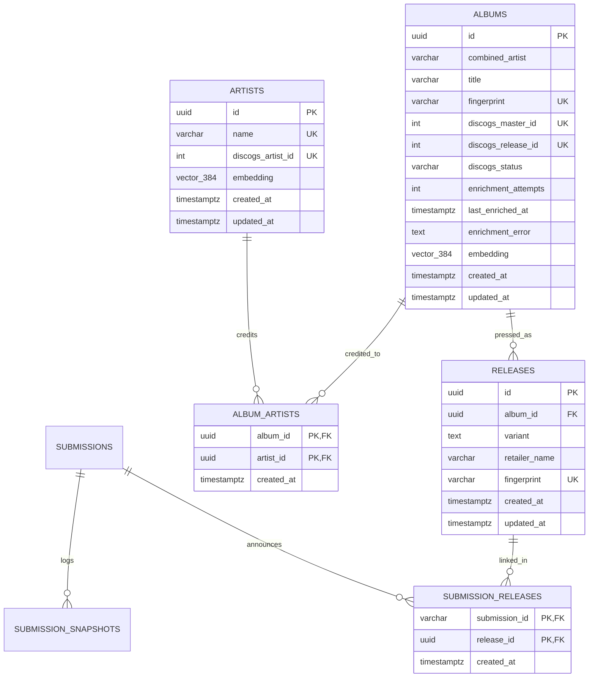

# Technical Specification: Discogs Catalog Enrichment & 3-Tier Artist–Album–Release Architecture

## Problem Statement

While the initial `r/vinylreleases` ingestion and extraction pipeline extracts structured release entities and aligns against local vector candidates, several structural and data-quality limitations remain:

1. **Flat 2-Tier Schema Conflates Musical Works and Physical Pressings**: Storing `combined_artist`, `album_title`, and vector `embedding` directly on `releases` duplicates musical work metadata across every color variant and retailer exclusive of the same album, preventing a normalized catalog view of an `Album` and its child `Release` editions.
2. **No External Authoritative Catalog Grounding**: Relying solely on Reddit submission titles leaves canonical artist names, split billings, diacritics, punctuation, and work titles vulnerable to community formatting quirks, typos, and inconsistent capitalization when an album first enters the database.
3. **Edition & Remaster Noise in Work Titles**: Reddit submission titles frequently embed anniversary, remaster, reissue, and deluxe descriptors alongside the album name, which causes external database searches (`GET /database/search?q=`) to fail due to strict boolean `AND` token matching.
4. **Rate-Limit & Latency Constraints on External APIs**: The Discogs API enforces a strict 60 requests/minute authenticated ceiling. Querying Discogs synchronously inside the Reddit ingestion or Pass 1 LLM extraction loop would bottleneck ingestion and risk `HTTP 429` exhaustion during release surges.
5. **The Pre-Order Gap**: Community announcements on `r/vinylreleases` frequently precede community-submitted Discogs Master/Release entries by days or weeks, requiring partial enrichment (matching known `Artist` entities immediately while standardizing the new `Album` via web search and scheduling periodic background re-checks).

---

## Solution

A 3-tier normalized relational catalog (`Artist` $\leftrightarrow$ `Album` $\leftrightarrow$ `Release`) paired with a decoupled two-pass **3-Tier RAG Resolution Cascade**:

1. **Normalized 3-Tier Relational Schema (`artists`, `albums`, `album_artists`, `releases`, `submission_releases`)**: Separates the canonical musical work (`Album`) and its contributing creators (`Artist` via `album_artists`) from commercial physical variants (`Release`), with persistent `Album`-level enrichment state tracking (`discogs_status`).
2. **Pass 1 — Local DB Vector RAG, Clean Work Extraction & Provisional Embeddings**:
   - Queries local PostgreSQL `Album` and `Artist` 384-d `fastembed` (`BAAI/bge-small-en-v1.5`) HNSW vector indexes (`Line 1`), hydrating existing sibling `Release` variants and retailers into the `Existing Catalog Reference` prompt.
   - Instructs the Pass 1 LLM extractor to isolate only the core musical work title into `album_title` while routing anniversary, remaster, reissue, and deluxe descriptors into `variant`.
   - Upserts `Album`, `Artist`, and `Release` records atomically with an immediate **provisional 384-d embedding** on new `Album` rows (`discogs_status = 'pending'`) so subsequent Reddit submissions arriving minutes later align immediately.
3. **Pass 2 — Decoupled `DiscogsEnrichmentWorker` & 5-Tier Discogs Search Cascade (`Line 2`)**:
   - Runs in a dedicated daemon thread (`"DiscogsEnrichmentWorker"`) inside `PollerService` (and inline at the end of `reddit-scrape run --once`), pulling eligible albums by priority (`pending` $\rightarrow$ due `failed` $\rightarrow$ due `partial_matched`) using detached I/O between short database transactions.
   - Queries `GET /database/search` (`per_page=5`) across a **5-tier fallback cascade** paced by a thread-safe 1.15s per-request rate limiter with adaptive header backpressure (`X-Discogs-Ratelimit-Remaining <= 5`) and `HTTP 429` / `5xx` retry handling.
   - Passes deduplicated search candidates with `fastembed` cosine similarity scores to a DeepSeek PydanticAI RAG arbiter, then performs **1 follow-up detail hydration call** (`GET /masters/{id}` or `GET /releases/{id}`) to extract structured `artists[]` (`discogs_artist_id`, `name`, `join`) while letting the LLM disambiguate Discogs numeric homonym suffixes (`Artist (2)`).
4. **Pass 2 Fallback — DeepSeek Native Web Search (`Line 3`)**:
   - When an album is not yet indexed on Discogs (`partial_matched` or `not_found`), queries DeepSeek's native Search API (`POST /v1/tools/search`, `count=10`, `need_content=True`) and reconciles the results via LLM to standardize `canonical_combined_artist`, `canonical_artists`, and `canonical_album_title`.
5. **In-Place Canonical Embedding Overwrite & Collision / Sibling Release Reconciliation**:
   - Overwrites `Album.embedding` and `Artist.embedding` in-place with canonical 384-d vectors, re-parents child records when canonical updates collide with an existing `Album` or `Artist`, and runs an LLM RAG sibling `Release` reconciliation pass when an `Album` has $\ge 2$ child `Release` rows to merge duplicate `(variant, retailer_name)` entries.

```mermaid
flowchart TD
    subgraph Pass1["Pass 1: Ingestion & ExtractionWorker (Line 1 Local DB Vector RAG)"]
        Sub["Unextracted Submission"]
        VecSearch["Query pgvector HNSW\n(Albums + Artists + Sibling Releases)"]
        LLMExtract["DeepSeek Extraction Agent\n(Clean Work Title + Variant Separation)"]
        PersistP1["Persist Artist / Album (pending + provisional embedding) / Release"]
        WakeWorker["Set _enrichment_trigger Event"]
    end

    subgraph Pass2["Pass 2: DiscogsEnrichmentWorker (Detached I/O Loop)"]
        Queue["Priority Queue Query (idx_albums_enrichment_queue)\nP0: pending | P1: due failed | P2: due partial_matched"]
        Cascade["Line 2: 5-Tier Discogs Search Cascade\n(1.15s rate limit + header backpressure)"]
        Arbiter["LLM RAG Candidate Arbiter\n(<=5 candidates + cosine similarity)"]
        Hydrate["Detail Hydration\n(GET /masters/{id} or /releases/{id})"]
        WebSearch["Line 3: DeepSeek Search API Fallback\n(POST /v1/tools/search, count=10, need_content=True)"]
        CommitP2["Write Tx 1: Update Canonical Artist/Album,\nOverwrite Canonical Embedding & Re-parent Collisions"]
        SiblingRAG["Phase 4: Sibling Release RAG Reconciliation\n(Write Tx 2 if >=2 child Releases have duplicates)"]
    end

    Sub --> VecSearch --> LLMExtract --> PersistP1 --> WakeWorker
    WakeWorker -.-> Queue
    Queue --> Cascade --> Arbiter
    Arbiter -->|Matched Master/Release| Hydrate --> CommitP2
    Arbiter -->|Unmatched Album\n(partial_matched / not_found)| WebSearch --> CommitP2
    CommitP2 --> SiblingRAG
```

---

## User Stories

1. As a vinyl collector, I want all physical variants and retailer exclusives of an album grouped under a single canonical `Album` record, so that I can view every pressing of a musical work in one place.
2. As a vinyl collector, I want multi-artist collaborations and split releases linked to both individual `Artist` records (`album_artists`) and an official `combined_artist` billing on `Album`, so that artist catalogs are complete and navigable.
3. As a data pipeline engineer, I want Pass 1 extraction to separate core musical work titles (`album_title`) from edition/remaster descriptors (`variant`), so that external catalog queries are not polluted by edition noise.
4. As a data pipeline engineer, I want new `Album` rows created in Pass 1 to receive an immediate provisional 384-d vector embedding, so that multiple Reddit posts for the same drop arriving minutes apart align in Line 1 Vector RAG before Pass 2 finishes.
5. As a data pipeline engineer, I want Line 1 Vector RAG to retrieve existing `Album` candidates alongside their existing child `Release` variants and retailers, so that Pass 1 aligns both the musical work and any existing variant/retailer strings.
6. As a pipeline operator, I want Discogs catalog enrichment to run asynchronously in a dedicated background thread (`DiscogsEnrichmentWorker`), so that Reddit polling and Pass 1 LLM extraction are never blocked by Discogs API rate limits.
7. As a developer running `reddit-scrape run --once`, I want pending enrichment processed synchronously at the end of the single cycle and reported via `enriched_count` on `CycleStats`, so that single-shot runs and CLI tests verify the full pipeline end-to-end.
8. As a pipeline operator, I want the Discogs client to enforce a 1.15-second minimum interval between requests, stretch pacing when `X-Discogs-Ratelimit-Remaining <= 5`, and honor `Retry-After` on `HTTP 429` / `5xx` responses, so that the scraper never violates Discogs' 60 req/min rate limit.
9. As a system architect, I want the worker to execute all Discogs HTTP calls, DeepSeek web searches, LLM calls, and `fastembed` computations outside database transactions, so that network latency never holds PostgreSQL locks or connections idle.
10. As a catalog curator, I want the worker to search Discogs using a 5-tier fallback cascade (`master` structured $\rightarrow$ `release` structured $\rightarrow$ `master` keyword $\rightarrow$ `release` keyword $\rightarrow$ constituent `artist` fallback), so that splits, unmastered vinyl EPs/7"s, and punctuation variations are reliably discovered.
11. As a catalog curator, I want the worker to hydrate a matched Discogs `master` or `release` via 1 follow-up `GET /masters/{id}` or `GET /releases/{id}` call, so that structured `artists[]` (`discogs_artist_id`, `name`, `join`) and `main_release` are captured accurately.
12. As a catalog curator, I want the LLM reconciliation arbiter to strip Discogs numeric homonym suffixes (e.g. ` Nirvana (2)` $\rightarrow$ `Nirvana`) while preserving legitimate parenthetical band names (e.g. `Sunn O)))`), so that canonical artist names are clean without fragile regex heuristics.
13. As a catalog curator, I want brand-new pre-order drops that match an existing Discogs `Artist` but have no Discogs `Album` yet to be marked `partial_matched`, standardized via DeepSeek Web Search (`POST /v1/tools/search`), and re-checked every 7 days for up to 60 days, so that the `discogs_master_id` links automatically once the community adds the release to Discogs.
14. As a catalog curator, I want albums with neither `Artist` nor `Album` on Discogs (`not_found`) to have their artist and album titles standardized via DeepSeek Web Search (`POST /v1/tools/search`) and their canonical vector embeddings updated in-place.
15. As a data pipeline engineer, I want transient enrichment failures (`failed`) to retry with exponential backoff (`5m * 2^(attempts - 1)`, capped at 5 attempts) using state persisted directly on `Album`, so that crashes or restarts never lose queue state.
16. As a data pipeline engineer, I want canonical collisions discovered during Pass 2 (when an enriched `Album` or `Artist` matches an already-persisted canonical record) to automatically re-parent child `album_artists` and `releases` and reconcile duplicate sibling `Release` rows via LLM RAG.

---

## Implementation Decisions

### 1. Normalized 3-Tier Relational Schema (`models.py`)

The database schema evolves from a flat `releases` table to a 3-tier `Artist` $\leftrightarrow$ `Album` $\leftrightarrow$ `Release` hierarchy (`GLOSSARY.md`, `ADR-0007`, `ADR-0008`). Because the project is pre-production, `init_db()` manages schema creation directly via `Base.metadata.create_all(bind=engine)` without Alembic migrations.



#### Exact SQLAlchemy Table Specifications

1. **`artists` (`Artist`)**:
   - `id`: `UUID(as_uuid=True)`, primary key, `default=uuid.uuid4`, `server_default=text("gen_random_uuid()")`
   - `name`: `String(255)`, `nullable=False`, `unique=True`, indexed (`idx_artists_name`)
   - `discogs_artist_id`: `Integer`, `nullable=True`, `unique=True`, indexed (`idx_artists_discogs_artist_id`)
   - `embedding`: `Vector(384)`, `nullable=True`, HNSW index (`idx_artists_embedding`, `postgresql_using="hnsw"`, `postgresql_ops={"embedding": "vector_cosine_ops"}`)
   - `created_at`: `DateTime(timezone=True)`, `server_default=func.now()`, `nullable=False`
   - `updated_at`: `DateTime(timezone=True)`, `server_default=func.now()`, `onupdate=func.now()`, `nullable=False`

2. **`albums` (`Album`)**:
   - `id`: `UUID(as_uuid=True)`, primary key, `default=uuid.uuid4`, `server_default=text("gen_random_uuid()")`
   - `combined_artist`: `String(255)`, `nullable=False`, indexed (`idx_albums_combined_artist`)
   - `title`: `String(255)`, `nullable=False`, indexed (`idx_albums_title`)
   - `fingerprint`: `String(64)`, `nullable=False`, `unique=True`, indexed (`idx_albums_fingerprint`, `sha256("{norm_combined_artist}|{norm_title}")`)
   - `discogs_master_id`: `Integer`, `nullable=True`, `unique=True`, indexed (`idx_albums_discogs_master_id`)
   - `discogs_release_id`: `Integer`, `nullable=True`, `unique=True`, indexed (`idx_albums_discogs_release_id`)
   - `discogs_status`: `String(32)`, `nullable=False`, `default="pending"`, `server_default=text("'pending'")` — allowed values: `'pending'`, `'matched'`, `'partial_matched'`, `'not_found'`, `'failed'`
   - `enrichment_attempts`: `Integer`, `nullable=False`, `default=0`, `server_default=text("0")`
   - `last_enriched_at`: `DateTime(timezone=True)`, `nullable=True`
   - `enrichment_error`: `Text`, `nullable=True`
   - `embedding`: `Vector(384)`, `nullable=True`, HNSW index (`idx_albums_embedding`, `postgresql_using="hnsw"`, `postgresql_ops={"embedding": "vector_cosine_ops"}`)
   - `created_at`: `DateTime(timezone=True)`, `server_default=func.now()`, `nullable=False`
   - `updated_at`: `DateTime(timezone=True)`, `server_default=func.now()`, `onupdate=func.now()`, `nullable=False`
   - Partial Index `idx_albums_enrichment_queue` on `(discogs_status, last_enriched_at, created_at)` with `postgresql_where=text("discogs_status IN ('pending', 'partial_matched', 'failed')")`

3. **`album_artists` (`AlbumArtist`)** *(replaces `release_artists`)*:
   - `album_id`: `UUID(as_uuid=True)`, `ForeignKey("albums.id", ondelete="CASCADE")`, primary key
   - `artist_id`: `UUID(as_uuid=True)`, `ForeignKey("artists.id", ondelete="CASCADE")`, primary key
   - `created_at`: `DateTime(timezone=True)`, `server_default=func.now()`, `nullable=False`

4. **`releases` (`Release`)**:
   - `id`: `UUID(as_uuid=True)`, primary key, `default=uuid.uuid4`, `server_default=text("gen_random_uuid()")`
   - `album_id`: `UUID(as_uuid=True)`, `ForeignKey("albums.id", ondelete="CASCADE")`, `nullable=False`, indexed (`idx_releases_album_id`)
   - `variant`: `Text`, `nullable=True`
   - `retailer_name`: `String(255)`, `nullable=True`
   - `fingerprint`: `String(64)`, `nullable=False`, `unique=True`, indexed (`idx_releases_fingerprint`, `sha256("{album_id}|{norm_variant}|{norm_retailer}")`)
   - `created_at`: `DateTime(timezone=True)`, `server_default=func.now()`, `nullable=False`
   - `updated_at`: `DateTime(timezone=True)`, `server_default=func.now()`, `onupdate=func.now()`, `nullable=False`

5. **`submission_releases` (`SubmissionRelease`)**:
   - Unchanged (`submission_id`, `release_id` composite PK with `ondelete="CASCADE"`).

---

### 2. Pass 1 — Clean Work Extraction, Sibling Release Vector RAG & Provisional Embeddings (`extraction.py`, `persistence.py`, `embeddings.py`)

#### 2.1 Clean Work Title vs. Edition Variant Separation
Discogs `GET /database/search?q=` applies a strict boolean `AND` across every token in the query. Including anniversary, remaster, reissue, or deluxe edition tags in `album_title` causes Discogs search queries to return `0` hits when the Discogs Master uses the original work title.
- Both `EXTRACTION_SYSTEM_PROMPT` and `BATCH_EXTRACTION_SYSTEM_PROMPT` in `extraction.py` must explicitly instruct the LLM:
  - **`album_title`**: Extract **only** the core canonical musical work title (e.g., `"Jane Doe"`, `"Illmatic"`, `" Bloodmoon: I"`). Strip anniversary, remaster, reissue, deluxe, expanded, and soundtrack edition descriptors from `album_title` unless they are an inseparable part of a distinct release's official title.
  - **`variant`**: Capture anniversary/remaster/reissue/deluxe edition descriptors alongside physical pressing variations (colorway, weight, LP count, run numbering), e.g., `"20th Anniversary Remaster, Blue & White Galaxy 2LP /1000"`.

#### 2.2 Embedding Text & Deterministic Fingerprints
- **Album Embedding Text (`embeddings.py`)**:
  `compute_album_text(combined_artist: str, album_title: str) -> str` formats `"{combined_artist.strip()} - {album_title.strip()}"`. (`compute_release_text` may be retained as a deprecated alias or updated so callers use `compute_album_text` for `Album.embedding`.)
- **Album Fingerprint (`persistence.py`)**:
  `compute_album_fingerprint(combined_artist: str, album_title: str) -> str` computes:
  ```python
  sha256(f"{normalize_attribute(combined_artist)}|{normalize_attribute(album_title)}")
  ```
- **Release Fingerprint (`persistence.py`)**:
  `compute_release_fingerprint(album_id: uuid.UUID | str, variant: str | None = None, retailer: str | None = None) -> str` computes:
  ```python
  sha256(f"{str(album_id).strip().lower()}|{normalize_attribute(variant, STANDARD_TOKEN)}|{normalize_attribute(retailer, STANDARD_TOKEN)}")
  ```

#### 2.3 Line 1 Vector RAG with Sibling Release Hydration
- `find_catalog_candidates(session, query_titles, top_k=5, min_similarity=0.50)`:
  1. Pre-cleans and batch-embeds `query_titles` using `fastembed` (`BAAI/bge-small-en-v1.5`, 384-d).
  2. Queries top-$k$ `Album` rows (`Album.embedding.cosine_distance(vec)`) and top-$k$ `Artist` rows (`Artist.embedding.cosine_distance(vec)`) with similarity $\ge 0.50$.
  3. Hydrates contributing artist names for matched `Album` rows via `AlbumArtist` $\rightarrow$ `Artist`.
  4. Queries existing child `Release` rows (`variant`, `retailer_name`) belonging to the matched `Album` IDs and formats them into `CatalogCandidates` so `format_catalog_reference()` presents both canonical `Album` metadata (`combined_artist`, `artists`, `album_title`) and known sibling `(variant, retailer)` pairs to the Pass 1 LLM prompt.

#### 2.4 Pass 1 Persistence & Provisional Embedding Lifecycle
- `persist_extracted_releases(session, submission_id, releases)`:
  1. Computes provisional 384-d embeddings for extracted `Album` (`"{combined_artist} - {album_title}"`) and `Artist` (`"{name}"`) texts in a single batch call.
  2. Upserts `Album` on `Album.fingerprint`:
     - On insert: sets `discogs_status = 'pending'`, `enrichment_attempts = 0`, and populates `Album.embedding` with the provisional vector.
     - On conflict (`Album.fingerprint`): updates `updated_at = func.now()` and preserves any existing `Album.embedding` (`func.coalesce(Album.embedding, excluded.embedding)`) and existing `discogs_status` (do **not** reset an already `'matched'`, `'partial_matched'`, or `'not_found'` album back to `'pending'`).
  3. Upserts each constituent `Artist` on `Artist.name` (preserving existing `Artist.embedding` and `Artist.discogs_artist_id`) and links `(album_id, artist_id)` in `album_artists` (`ON CONFLICT DO NOTHING`).
  4. Computes `Release.fingerprint` using the resolved `album_id`, `variant`, and `retailer`, upserts `Release` on `Release.fingerprint`, and links `(submission_id, release_id)` in `submission_releases` (`ON CONFLICT DO NOTHING`).
  5. Marks `submission.is_extracted = True`.
  6. When new or pending `Album` rows are persisted, `PollerService` sets `self._enrichment_trigger.set()` so the background `DiscogsEnrichmentWorker` wakes immediately.

---

### 3. Pass 2 — Discogs Client, 5-Tier Search Cascade & Detail Hydration (`discogs.py`)

#### 3.1 Authentication & Configuration (`service.py`, `discogs.py`)
- `validate_environment()` in `service.py` validates Discogs credentials:
  - Accepts either `DISCOGS_TOKEN` (Personal Access Token) **or** both `DISCOGS_CONSUMER_KEY` and `DISCOGS_CONSUMER_SECRET` (preferring `DISCOGS_TOKEN` if both are present). Raises `ValueError` if neither is configured.
  - Optional `DISCOGS_USER_AGENT` (defaults to `"VinylReleasesScraper/0.1.0"`).
  - Optional `ENRICHMENT_INTERVAL_SECONDS` (defaults to `60`, positive integer).
- Authorization headers sent on every request to `https://api.discogs.com`:
  - Token mode: `Authorization: Discogs token={discogs_token}`
  - Key/Secret mode: `Authorization: Discogs key={consumer_key}, secret={consumer_secret}`
  - `User-Agent: {discogs_user_agent}`
  - `Accept: application/vnd.discogs.v2.plaintext+json`

#### 3.2 Per-Request Rate Limiting, Adaptive Backpressure & `429`/`5xx` Retries
`DiscogsClient` enforces rate limiting across every individual HTTP call (including all search tiers and detail hydration calls):
- **Steady-State Floor**: Uses a `threading.Lock` and `time.monotonic()` to enforce a minimum **1.15-second** interval between consecutive HTTP requests (~52 req/min ceiling, safely below Discogs' 60 req/min authenticated limit).
- **Adaptive Header Backpressure**: Inspects `X-Discogs-Ratelimit-Remaining` on every HTTP response. When `Remaining <= 5`, stretches the next pre-request delay to `max(5.0, 60.0 / max(1, remaining))` seconds until `Remaining > 5`.
- **Interruptible Waiting**: All rate-limit sleeps and retry waits use `shutdown_event.wait(timeout=delay)` (when a `shutdown_event` is supplied) so `SIGINT`/`SIGTERM` interrupts immediately without hanging.
- **`HTTP 429` & Transient `5xx` Retry Policy**:
  - On `HTTP 429 Too Many Requests` or `HTTP 500/502/503/504`, reads the `Retry-After` header (defaulting to `60.0` seconds for `429` or `5.0` seconds for `5xx` if absent/non-numeric), waits via `shutdown_event.wait(timeout=...)`, and retries up to **2 times** per request before raising `DiscogsAPIError`.

#### 3.3 5-Tier Discogs Search Cascade
For an eligible `Album` (`combined_artist`, `title`, and constituent `artists`), the enrichment worker executes up to 5 search tiers against `GET /database/search` with `per_page=5`, stopping as soon as a tier yields a verified LLM match:

| Tier | Endpoint & Query Parameters | Purpose |
| :--- | :--- | :--- |
| **Tier 1** | `GET /database/search?type=master&artist={combined_artist}&release_title={title}&per_page=5` | Primary structured lookup for canonical Discogs Masters. |
| **Tier 2** | `GET /database/search?type=release&artist={combined_artist}&release_title={title}&format=Vinyl&per_page=5` | Catches vinyl releases that lack a Master or have a `master_id` link not surfaced by `type=master`. |
| **Tier 3** | `GET /database/search?type=master&q={combined_artist} {title}&per_page=5` | Unquoted combined keyword lookup; resolves reversed split billings (e.g. `Dropdead / Converge` vs `Converge / Dropdead`) and punctuation differences. |
| **Tier 4** | `GET /database/search?type=release&q={combined_artist} {title}&format=Vinyl&per_page=5` | Catches unmastered 7" splits, EPs, and singles where artist/title boundaries differ. |
| **Tier 5** | `GET /database/search?type=artist&q={artist_name}&per_page=5` *(per unlinked constituent `Artist`)* | Executed when Tiers 1–4 fail to match the `Album`. Skips any constituent `Artist` that already has a `discogs_artist_id` in PostgreSQL. |

#### 3.4 Candidate Cosine Similarity & LLM RAG Arbiter
- **No Hard Cosine Drop Filter**: All deduplicated candidates (`<= 5` per tier) are passed to the LLM reconciliation prompt. Local CPU `fastembed` (`BAAI/bge-small-en-v1.5`) cosine similarity between `"{combined_artist} - {title}"` and each candidate's `title` is computed and included in the prompt as an informational signal alongside the Discogs search rank, `id`, `type`, `master_id`, `year`, `country`, and `format`.
- **Selection & Promotion Rules**:
  - If the LLM arbiter confirms a candidate from Tiers 1–4 represents the same musical work:
    - If the winning candidate is `type == "master"`, `resolved_master_id = candidate.id`.
    - If the winning candidate is `type == "release"` and has a non-null `master_id`, promote to `resolved_master_id = candidate.master_id` (and also record `resolved_release_id = candidate.id` if no Master detail can be fetched). If `master_id` is `None`/0 (an unmastered standalone release), set `resolved_release_id = candidate.id` and `resolved_master_id = None`.

#### 3.5 Follow-Up Detail Hydration (`GET /masters/{id}` or `GET /releases/{id}`)
Because `GET /database/search` returns only a flat `"Artist - Album"` string in `title` and omits structured artist IDs:
1. After selecting a winning work candidate from Tiers 1–4, the worker executes **1 follow-up detail request**:
   - `GET /masters/{resolved_master_id}` when `resolved_master_id` is present.
   - `GET /releases/{resolved_release_id}` when the release is unmastered (`resolved_master_id is None`).
2. From the detail payload (`artists[]`, `title`, `main_release`, `year`), the worker extracts the raw Discogs artist credits (`id`, `name`, `anv`, `join`) and work `title`.
3. **LLM-Driven Artist Disambiguation**: Raw Discogs artist names (which may include numeric homonym suffixes like `"Nirvana (2)"` or `"Blink (3)"`) are passed to the LLM reconciliation prompt (or structured post-hydration reconciliation step) so the LLM outputs:
   - Clean canonical individual artist names paired with their `discogs_artist_id` (stripping Discogs homonym suffixes like `(2)` while preserving genuine parenthetical band names like `Sunn O)))`).
   - Reconstructed canonical `combined_artist` billing using Discogs `artists[].join` delimiters (e.g. `"Converge / Dropdead"` or `"Kanye West & Ty Dolla $ign"`).
   - Clean canonical `album_title` (using Discogs `title`).

---

### 4. Line 3 — DeepSeek Native Web Search Fallback (`enrichment.py`)

When Tiers 1–4 find no matching `Album` on Discogs (leaving the album either `'partial_matched'` if Tier 5 or an existing DB record matched at least one `Artist.discogs_artist_id`, or `'not_found'` if no `Artist` matched on Discogs):

1. **DeepSeek Native Web Search Call**:
   - Executes `POST {deepseek_base_url}/v1/tools/search` via `httpx` with header `Authorization: Bearer {deepseek_api_key}`:
     ```json
     {
       "query": "{combined_artist} {album_title} vinyl album",
       "count": 10,
       "need_content": true
     }
     ```
     *(with `query` truncated to `[:128]` characters).*
2. **LLM Web Search Reconciliation**:
   - Formats the returned search hits (`title`, `url`, `summary`, `snippet`, and a bounded excerpt of `content`, ordered by `rerank_score`) into the DeepSeek PydanticAI reconciliation agent.
   - Outputs structured `{canonical_combined_artist: str, canonical_artists: list[str], canonical_album_title: str}` to standardize capitalization, diacritics, and official title spelling even when Discogs has no entry yet.
   - If the web search endpoint errors or returns 0 usable results, gracefully retains the Pass 1 extracted names as canonical so embedding generation and state transition still succeed.

---

### 5. Worker Concurrency, Priority Queue & Detached Multi-Step Transactions (`enrichment.py`, `service.py`)

#### 5.1 Worker Lifecycle in `PollerService`
- **Continuous Mode (`reddit-scrape run`)**:
  - `PollerService` starts a daemon thread `threading.Thread(target=self._enrichment_worker_loop, name="DiscogsEnrichmentWorker", daemon=True)` alongside `"ExtractionWorker"`.
  - Coordinated via `self._enrichment_trigger = threading.Event()` and `self._shutdown_event`.
  - Pass 1 persistence calls `self.trigger_enrichment()` (`self._enrichment_trigger.set()`) whenever submissions are extracted.
  - When idle, `_enrichment_worker_loop` wakes every `enrichment_interval_seconds` (default `60s`) to sweep due `'failed'` retries and `'partial_matched'` 7-day re-checks.
- **Single-Cycle Mode (`reddit-scrape run --once`)**:
  - `poll_and_extract_cycle()` calls `process_pending_enrichment()` synchronously after `process_unextracted_submissions()`.
  - `CycleStats` adds `enriched_count: int = 0`, and `cli.py` logs `enriched={stats.enriched_count}` in `--once` output.

#### 5.2 Priority Queue Selection & State Machine Rules
Queue selection queries `albums` using partial index `idx_albums_enrichment_queue`:

1. **Priority 0 (`'pending'`)**:
   `discogs_status = 'pending'`
2. **Priority 1 (`'failed'`)**:
   `discogs_status = 'failed' AND enrichment_attempts < 5 AND last_enriched_at <= now() - (interval '5 minutes' * power(2, enrichment_attempts - 1))`
   *(Backoff schedule: 5m, 10m, 20m, 40m after attempts 1–4; dead-lettered at `enrichment_attempts >= 5`).*
3. **Priority 2 (`'partial_matched'`)**:
   `discogs_status = 'partial_matched' AND last_enriched_at <= now() - interval '7 days' AND created_at >= now() - interval '60 days'`
   *(Re-checked every 7 days for up to 60 days after album creation; ages out after 60 days while retaining `discogs_status = 'partial_matched'`).*

Ordering: `CASE discogs_status WHEN 'pending' THEN 0 WHEN 'failed' THEN 1 WHEN 'partial_matched' THEN 2 END ASC`, then `created_at ASC`, `last_enriched_at ASC NULLS FIRST`.

#### 5.3 Four-Phase Detached Transaction Protocol per Album
To guarantee that slow HTTP/LLM calls never hold database locks:

- **Phase 1 (Short Read Tx)**:
  Fetch the next eligible `Album` row and its linked `Artist` rows (`id`, `name`, `discogs_artist_id`), then close the session.
- **Phase 2 (Detached Network & CPU I/O — Zero Open DB Session)**:
  1. Execute the Line 2 Discogs 5-tier search cascade + LLM candidate arbitration + 1 detail hydration call (`GET /masters/{id}` or `GET /releases/{id}`).
  2. If the `Album` remains unmatched on Discogs (`'partial_matched'` or `'not_found'`), execute Line 3 DeepSeek native web search (`POST /v1/tools/search`) + LLM reconciliation.
  3. Compute canonical 384-d `fastembed` embeddings for the canonical `Album` (`"{canonical_combined_artist} - {canonical_title}"`) and each canonical `Artist` (`"{canonical_artist_name}"`).
- **Phase 3 (Short Write Tx 1 — Canonical Commit & Collision Re-Parenting)**:
  1. **Artist Upsert / Collision Merge**:
     For each resolved constituent artist: check if another `Artist` row already owns the target `discogs_artist_id` or `Artist.name`. If a collision exists on a different `Artist.id`, re-parent `album_artists` references (`INSERT ... ON CONFLICT DO NOTHING` + delete old link), delete the superseded `Artist` row if orphaned, and update the surviving `Artist`'s `name`, `discogs_artist_id`, `embedding`, and `updated_at`.
  2. **Album Update / Collision Merge**:
     Compute the new canonical `Album.fingerprint`. Check if another `Album` row already owns `discogs_master_id`, `discogs_release_id`, or `Album.fingerprint`:
     - **No Collision**: Update `combined_artist`, `title`, `fingerprint`, `discogs_master_id`, `discogs_release_id`, overwrite `Album.embedding` in-place with the canonical vector, set `discogs_status` (`'matched'`, `'partial_matched'`, or `'not_found'`), reset `enrichment_attempts = 0` and `enrichment_error = None`, and set `last_enriched_at = func.now()`. Recompute `Release.fingerprint` (`sha256("{album_id}|{norm_variant}|{norm_retailer}")`) for child `Release` rows if needed.
     - **Canonical `Album` Collision**: Re-parent `album_artists` to the surviving canonical `Album` (`ON CONFLICT DO NOTHING`). Re-parent child `Release` rows from the duplicate `Album` to the surviving `Album`: if a child `Release`'s new fingerprint (`sha256("{surviving_album_id}|{norm_variant}|{norm_retailer}")`) collides with an existing `Release` on the surviving `Album`, re-link `submission_releases` (`ON CONFLICT DO NOTHING`) and delete the duplicate `Release` row; otherwise update `Release.album_id` and `Release.fingerprint`. Delete the superseded `Album` row, and update the surviving `Album`'s Discogs IDs, status, and canonical embedding.
  3. Read all child `Release` rows (`id`, `variant`, `retailer_name`) of the surviving `Album` and commit Write Tx 1.
- **Phase 4 (Detached Sibling `Release` RAG Reconciliation + Short Write Tx 2)**:
  - Triggered only when the surviving `Album` has $\ge 2$ child `Release` rows.
  - Outside any DB session, pass the list of sibling `Release` rows (`id`, `variant`, `retailer_name`) to the LLM sibling reconciliation agent to identify groups of rows that represent the exact same commercial `(variant, retailer_name)` expressed with different wording (e.g. `"Pink /500"` vs `"Limited Pink Vinyl (500 copies)"`).
  - If duplicate groups are returned, open **Write Tx 2**: for each group, keep the canonical `Release` row, update its standardized `(variant, retailer_name, fingerprint)`, re-link `submission_releases` from duplicate `Release` IDs to the surviving `Release` ID (`ON CONFLICT DO NOTHING`), and delete the duplicate `Release` rows.

---

## Testing Decisions

### What Makes a Good Test
Tests must verify external observable behavior across module seams without coupling to private helpers:
1. **3-Tier Schema & Pass 1 Persistence (`tests/test_persistence.py`, `tests/test_models.py`)**:
   - Verify `persist_extracted_releases` creates normalized `Artist`, `Album` (`discogs_status='pending'`, provisional 384-d `embedding` populated), `AlbumArtist`, `Release` (`album_id` FK), and `SubmissionRelease` records.
   - Verify multiple variants/retailers of the same album share a single `Album` row while creating distinct child `Release` rows.
   - Verify `find_catalog_candidates` queries `Album.embedding` and `Artist.embedding` and hydrates sibling `Release` variants/retailers into `CatalogCandidates`.
   - Verify re-ingesting a submission for an already `'matched'` album preserves `Album.discogs_status = 'matched'` and its canonical embedding.
2. **Pass 1 Clean Work Title Extraction (`tests/test_extraction.py`)**:
   - Verify `EXTRACTION_SYSTEM_PROMPT` and `BATCH_EXTRACTION_SYSTEM_PROMPT` instruct separating edition/remaster noise into `variant` and formatting `CatalogCandidates` with album and sibling release references.
3. **Discogs HTTP Client & Rate Limiter (`tests/test_discogs.py`)**:
   - Verify authentication header construction for both `DISCOGS_TOKEN` and `DISCOGS_CONSUMER_KEY`/`SECRET`, plus custom `User-Agent`.
   - Verify 1.15s monotonic pacing between calls, adaptive delay stretching when `X-Discogs-Ratelimit-Remaining <= 5`, and `Retry-After` backoff on `HTTP 429` and `5xx` responses.
4. **Enrichment Worker & 5-Tier Cascade (`tests/test_enrichment.py`)**:
   - Verify the 5-tier search cascade (`master` structured $\rightarrow$ `release` structured $\rightarrow$ `master` keyword $\rightarrow$ `release` keyword $\rightarrow$ constituent `artist` fallback) and 1 follow-up `/masters/{id}` or `/releases/{id}` hydration call.
   - Verify full `'matched'` enrichment updates `Artist.discogs_artist_id`, `Album.discogs_master_id`/`discogs_release_id`, overwrites `Album.embedding` in-place, and strips numeric disambiguation suffixes (`Artist (2)`) while preserving parenthetical band names (`Sunn O)))`).
   - Verify `'partial_matched'` and `'not_found'` flows invoke Line 3 DeepSeek native Search API (`POST /v1/tools/search`, `count=10`, `need_content=True`) and transition state accurately.
   - Verify priority ordering (`pending` > due `failed` > due `partial_matched`), exponential backoff (`5m * 2^(attempts-1)`, max 5 attempts), and 60-day pre-order window expiry.
   - Verify canonical `Album`/`Artist` collision re-parenting and Phase 4 sibling `Release` RAG deduplication.
5. **Service & CLI Integration (`tests/test_service.py`, `tests/test_cli.py`)**:
   - Verify `validate_environment` checks Discogs credentials (`DISCOGS_TOKEN` or key/secret pair).
   - Verify `PollerService` starts `"DiscogsEnrichmentWorker"` in continuous mode and runs `process_pending_enrichment()` inline during `run_once()`, reporting `enriched_count` on `CycleStats`.

---

## Out of Scope

- Discogs Marketplace pricing, price suggestions, inventory trading, and sale listings.
- User personal collection sync, wantlist tracking, or OAuth 3-legged user authorization.
- Barcode scanning and runout / matrix etching matching.
- Synchronous inline Discogs API querying during Reddit ingestion or Pass 1 LLM extraction loops.
- Server-side image proxy/S3 caching for `i.discogs.com` cover artwork (deferred until a frontend/UI consumer is introduced).

---

## Further Notes

- **Configuration Environment Variables**:
  - `DISCOGS_TOKEN` (optional if consumer key/secret provided)
  - `DISCOGS_CONSUMER_KEY`, `DISCOGS_CONSUMER_SECRET` (optional if `DISCOGS_TOKEN` provided)
  - `DISCOGS_USER_AGENT` (default: `"VinylReleasesScraper/0.1.0"`)
  - `ENRICHMENT_INTERVAL_SECONDS` (default: `60`)
- **Related Domain & Architecture Records**:
  - `GLOSSARY.md` (`Artist`, `Combined Artist`, `Album`, `Release`, `Variant`, `Canonical Alignment`, `Catalog Enrichment`, `Enrichment State`)
  - `docs/adr/0007-vector-canonical-alignment.md`
  - `docs/adr/0008-three-tier-rag-catalog-enrichment.md`
  - Prototype reference: [`prototype/discogs-enrichment`](https://github.com/Lolgend/vinyl-reddit-scrape/tree/prototype/discogs-enrichment) (`src/reddit_scrape/discogs_enrichment_prototype.html`)
  - Research references: [`research/discogs-search-api`](https://github.com/Lolgend/vinyl-reddit-scrape/tree/research/discogs-search-api) and [`research/discogs-payload-structures`](https://github.com/Lolgend/vinyl-reddit-scrape/tree/research/discogs-payload-structures)
